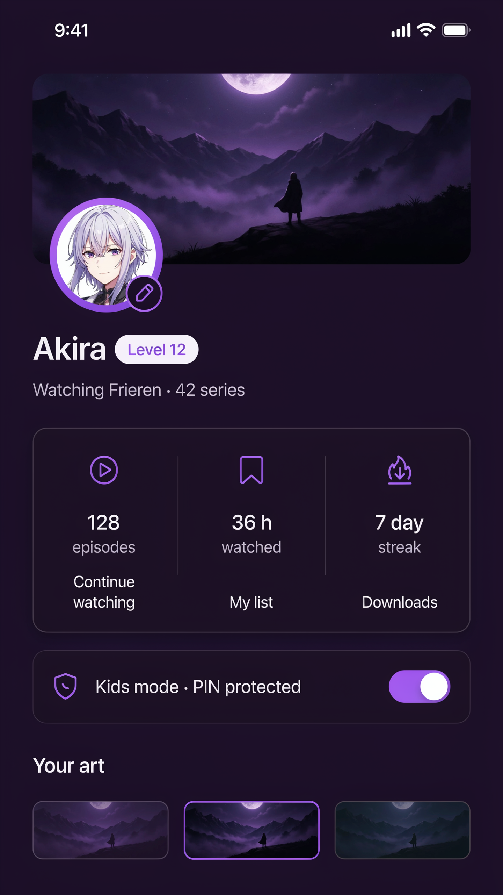
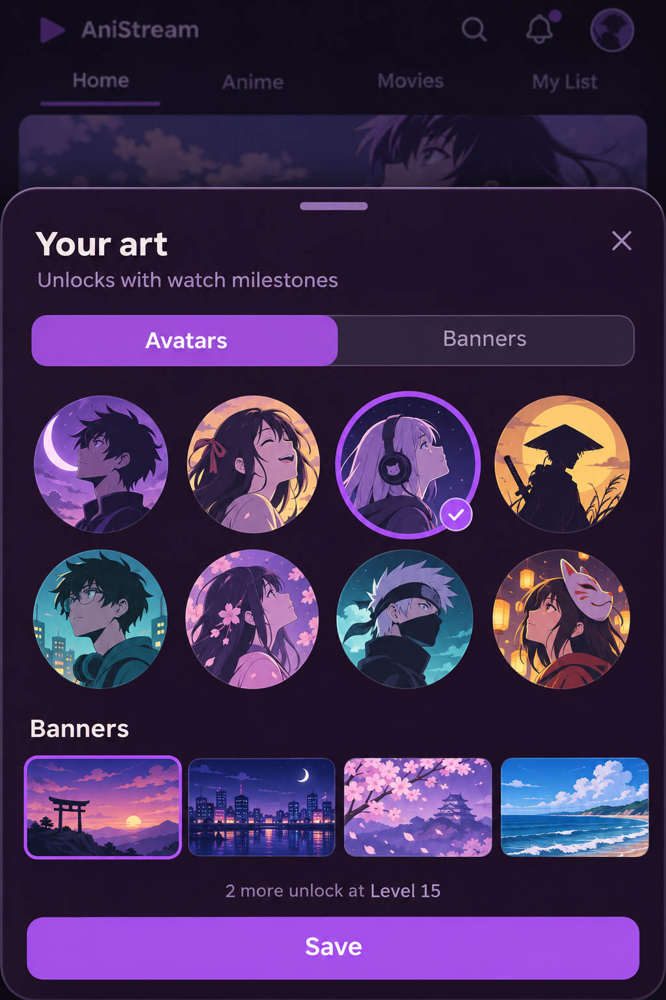
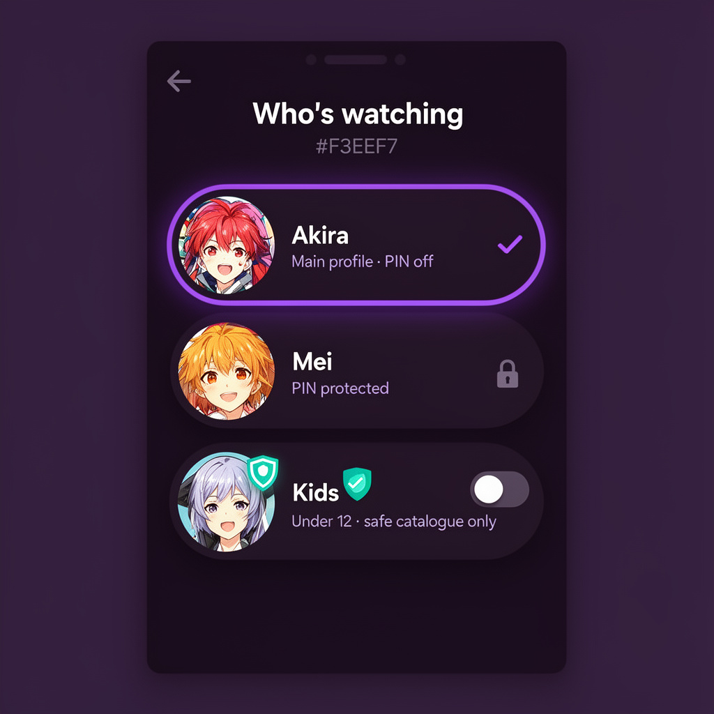

# Account section — improvement proposal

Three mockups (`design/`) and the concrete changes behind each. All of it fits the parts of Kuro
that already exist: the profile markup in `accounts542.js`, the art presets in
`profile-presets571.css`, the dialog palette in `KuroDialogs581`, and the motion tokens in
`assets/smooth-ui.css` (`--ku-fast 140ms`, `--ku-mid 240ms`, `--ku-slow 420ms`,
`--ku-ease-out`, `--ku-spring`). Nothing here needs a new backend.

> Mockups are concept art, not pixel specs: the second one carries stray "AniStream" branding and
> the third has a leftover `#F3EEF7` label — ignore those. All artwork in them is placeholder and
> would be replaced by Kuro's own generated/commissioned set (see *Assets* at the end).

---

## 1. Profile home — give the page a reason to exist

Today the profile page is a hero (banner + avatar + name) above a stack of settings cards. It tells
you who you are but nothing about what you've done, and the only actions on it are configuration.

**What to add, top to bottom**

| Change | Why | Effort |
|---|---|---|
| **Stat strip** — episodes · hours · streak | All three are derivable from the history already stored locally (`history`/`progress` keys). No sync, no new service. Turns a settings page into a "your year in anime" glance. | S — one computed block, cached on view |
| **Level pill next to the name** | Cheap belonging: level = f(hours watched). Gives the art picker something to unlock against. | S — pure function of the same stats |
| **"Watching <title> · N series" subtitle** | Cheapest possible "continue" affordance, one tap into the player. | S |
| **Three action tiles** — Continue watching / My list / Downloads | These exist as tabs today; the tiles make the profile a launcher instead of a dead end. | M — reuse existing routes |
| **Kids mode row with a real switch** | The toggle is the honest UI for item #12; it must actually change behaviour (see §3). | M |
| **"Your art" strip** | Exposes that banners/avatars are changeable at all — right now the presets grid is buried. | S |

**Motion / polish specifics**

- Hero keeps the existing transform-only parallax (`smooth-ui.js` rAF), but the **avatar gets its own
  layer** so the ring can scale `1.0 → 1.03` on press with `--ku-spring` while the banner drifts.
- Stats animate **once per mount**: numbers count up over `--ku-mid` and stop; they must not re-run on
  scroll, or the page feels busy.
- The three stat cells and three action tiles enter with the same `--ku-i` stagger variable already
  used by the avatar grid (60 ms apart), so the page reads as one gesture.
- Every tile is a real focus target with `:focus-visible` ring; DPAD order is hero → stats → actions →
  kids → art. Back from this screen must land on Home, not exit.
- Under *Remove animations* everything collapses to an instant state change — the stats show final
  values immediately, no count-up.

---

## 2. "Your art" picker — a sheet, not a buried grid

**What changes**

- **Promote the preset grid into a bottom sheet** opened from the avatar's pencil badge *and* from the
  "Your art" strip. Same component, two entry points — no more hunting in settings.
- **Two segments: Avatars / Banners.** Today banner and avatar choice are separate controls in the same
  long list; a segmented sheet makes the pairing obvious ("pick a face, pick a backdrop, save").
- **Preview on the live hero, not on a card.** The sheet sits over a dimmed profile page, and tapping a
  tile updates the hero behind it instantly (fade-in already implemented). Save/close keeps it; there is
  no separate "apply" step to get wrong.
- **Locked art with a reason.** Grey-dimmed tiles with a small lock and a single muted line
  ("2 more unlock at Level 15"). This is the only place gamification should appear — never a nag on the
  home screen.
- **Selection state is unambiguous:** 2px accent ring + check badge, plus `aria-selected`. Today the
  selected preset is only a border colour, which is invisible on some banner art.
- **Sheet motion:** slides up with `--ku-slow` and `--ku-ease-out`, scrim fades with `--ku-mid`; DPAD
  focus is trapped inside the sheet, opens on the current selection, and `Back` closes the sheet before
  it leaves the page.

**Data cost:** the selection is already persisted per preset id. Adding `locked` is a static table
(`preset → level`) in `profile-presets571.css`'s companion JS — no schema change, and users who never
reach level 15 simply see the same grid they have now.

---

## 3. "Who's watching" — profiles and kids mode done honestly

This is item #12, and it is the change with the most real value — and the most places it can be fake.
A cosmetic kids switch would be worse than none.

**The screen**

- **Profile cards, not a dropdown.** Avatar + name + one line of state (`Main profile · PIN off`,
  `PIN protected`, `Under 12 · safe catalogue only`), current profile ringed in accent with a check.
- **Padlock on PIN-protected profiles.** Tap → the themed `KuroDialogs581` PIN sheet (4–6 digits,
  DPAD-friendly keypad, single error line, no shake animation under reduced motion).
- **Kids badge is teal, not purple.** One colour that means "restricted" everywhere in the app, so a
  parent can spot it at a glance from across the room.
- **Add profile** as a dashed card — visible but visually secondary.
- **Footer explains the switch in one sentence**, because a toggle whose effects are invisible will be
  turned on and forgotten.

**What Kids mode must actually do to be worth shipping**

1. Hide mature/18+ titles in lists and search (needs a genre/tag filter over the catalogue already being
   parsed — this is the expensive part, and it belongs with #9 search v2).
2. Block **casting to unknown devices** — a cast sent from a kid profile should stop at the PIN gate.
3. Lock settings changes (sources, updates, sign-out) behind the PIN.
4. Separate history/progress per profile; switching profiles must not leak the adult's continue-watching.

If 1 and 4 can't land in the same build, ship the switcher **without** the kids toggle rather than a
toggle that only hides a badge.

**Multi-profile plumbing (the part that changes the app's shape)**

- Every storage key gains a profile scope: `kuro:profile:<id>:history`, `:progress`, `:list`, `:settings`.
  A one-time migration copies the existing unscoped keys into the default profile so nobody loses
  history on update.
- Profile list + PIN hash live in one small JSON blob (`kuro:profiles`); PIN stored as
  `sha256(salt || pin)` with a per-profile salt — four digits on a local device, so this is
  shoulder-surfing defence, not cryptography theatre.
- If cloud sync is ever wanted, this blob is exactly what a Supabase table would hold — one row per
  profile, but that is a later conversation, not a prerequisite.

---

## Ranked shortlist

**P0 — small, visible, no data model change (a single build)**
1. Stat strip + level pill on the profile hero.
2. "Your art" strip that opens the existing presets as a sheet.
3. Selection ring + check badge on presets; locked tiles with a level hint.
4. Focus order and `Back` behaviour on the account page (DPAD acceptance).
5. Avatar press-scale + hero parallax separation in `smooth-ui.css`.

**P1 — the profile system**
6. Profile switcher screen with avatars, PIN pads and per-profile storage keys + migration.
7. Kids mode toggle wired to settings lock + cast gate (catalogue filtering to follow).
8. Per-profile history/list/progress split.

**P2 — the garnish**
9. Streak calculation with a sensible "lost yesterday" rule (never scold).
10. Watch-milestone notifications that unlock art (reuse the notification channel work from #11).
11. "Year in anime" summary sheet at the end of a season, built from the same stats.

---

## Assets

The avatar/banner set is the biggest *non-code* dependency: 8–12 avatars and 4–6 banners, flat
illustration on the app palette, consistent line weight and eye style. They should be generated in
one batch so they look like a set, sized 512×512 (avatars) and 1600×600 (banners), and the manifest
(`preset → level → file`) kept in one JS file so adding a tenth avatar is a one-line change.

## What I would not do

- **No social layer.** No followers, no public profile, no "share my list" — Kuro is a player, and
  every social surface brings moderation obligations that don't fit a sideloaded app.
- **No forced onboarding picker.** If a user has one profile, land them straight on the account page;
  show "Who's watching" only when there are two or more, or on explicit switch.
- **No streak guilt.** Missing a day resets quietly; no red banners, no "you lost your streak" toast.
