# Kuro TV — Releases

Kuro TV is an anime streaming app (Android, versionCode 132, versionName `1.5.5-libs18-fastfail`)
with a unified multi-source search over 17+ streaming providers, HLS playback, mirror failover,
and a themeable UI with a teal default accent.

This repository hosts the app preview images and the release source artifacts.

## App Screen Previews

| Detail / Catalog | Search | Library | Player |
| --- | --- | --- | --- |
| 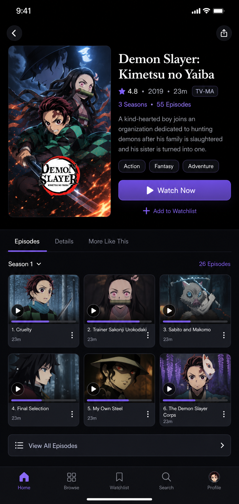 | 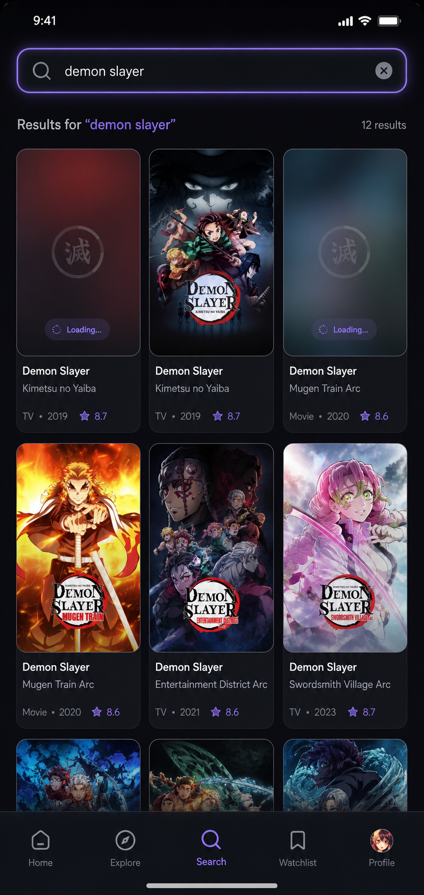 | 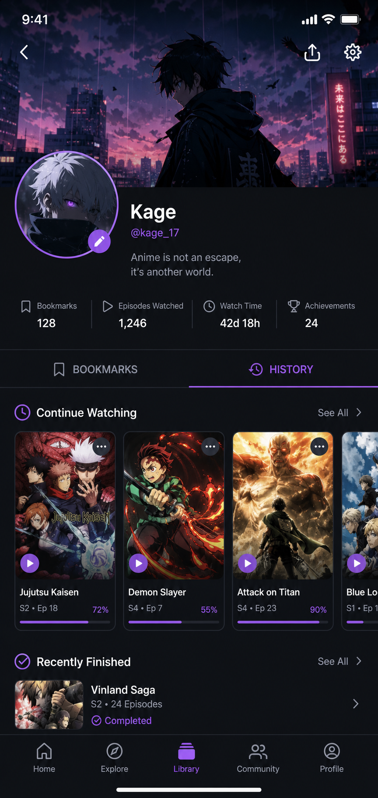 | 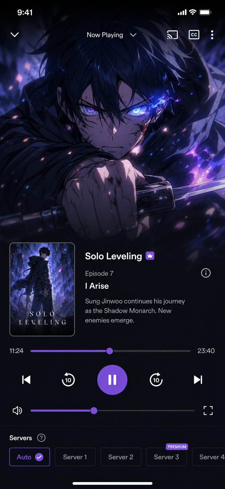 |

## Visual Preview

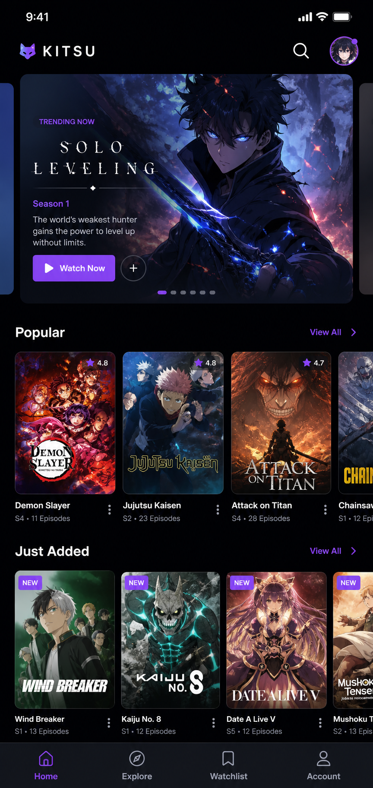

## Profile Art Previews

Profile pictures (PFP) with matching banners, as shown in the profile art section.

| Set 1 | Set 2 |
| --- | --- |
| 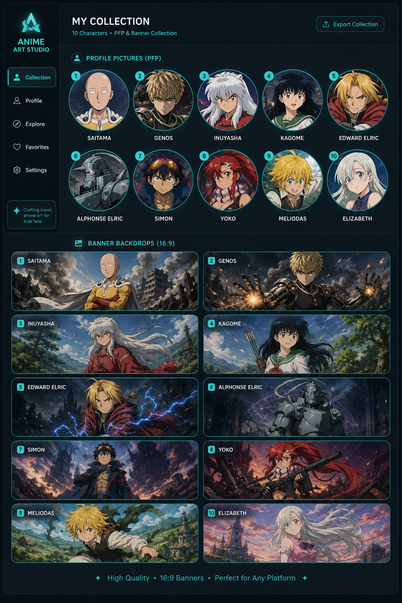 | 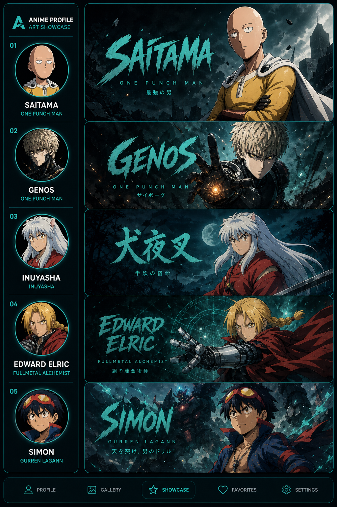 |

### Manga-style PFP + Banner Sets

The manga-style profile art sets (2, 3 and 4 below are shipped in the app as profile art entries).

| Set 1 | Set 2 |
| --- | --- |
| 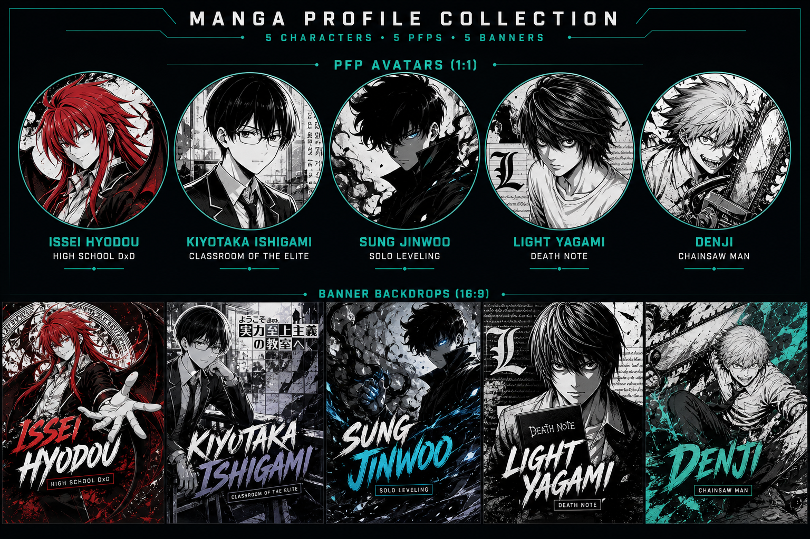 | 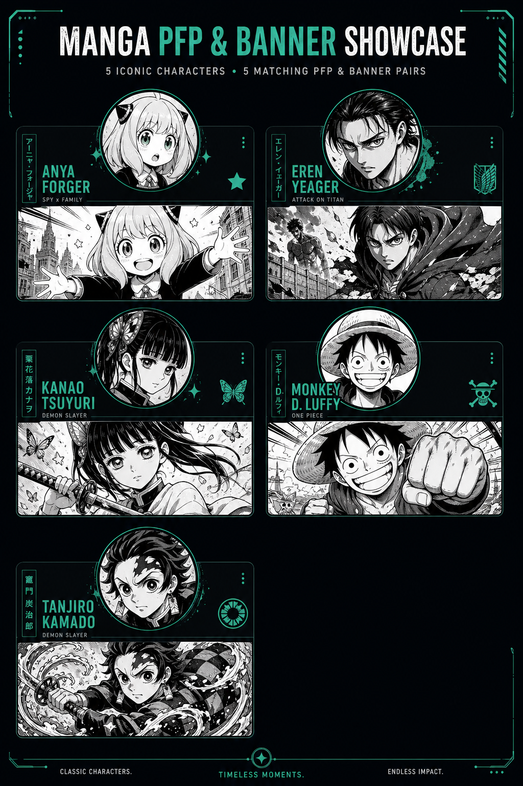 |

| Set 3 | Set 4 |
| --- | --- |
| 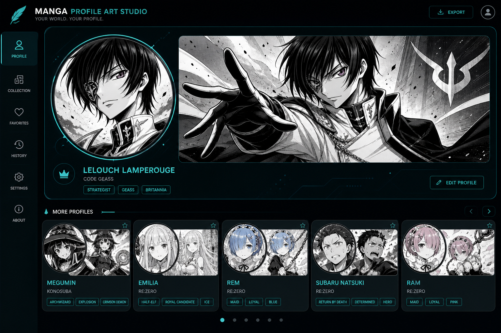 | 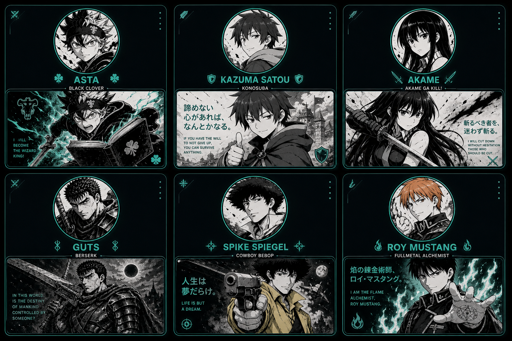 |

## Repository Layout

| Path | Contents |
| --- | --- |
| `kuro-*.png` | App screen, visual, and profile-art preview images shown above |
| `google_drive/v4/` | **Latest** source release: `Kuro-1.5.5-libs18-fastfail-vc132-source-v4.zip`, source as `.txt`, and `SHA256SUMS.txt` |
| `google_drive/v3/` | Superseded v3 source artifacts (teal default + 3 manga-style profile art entries) |
| `google_drive/v2/` | Superseded v2 source artifacts |

## Latest Release (v4)

- `Kuro-1.5.5-libs18-fastfail-vc132-source-v4.zip` — full Android source, ready to build
- Source as plain text for quick browsing/diffing
- `SHA256SUMS.txt` — checksums for verification

v4 adds six features on top of v3:

1. **Domain health sweeper** — probes 20 streaming domains every 10 minutes, prunes dead mirrors automatically
2. **Position-lock on server switch** — remembers playback position across failover server switches
3. **Brute-force quality render** — 1080p→720p→480p→360p fallback on playback errors (HLS + direct URLs)
4. **Unified search default** — all sources searched at startup instead of a single provider
5. **Live theme accent preview** — real catalogue/player/dialog samples update instantly per swatch
6. Teal default theme + 3 manga-style profile art entries (from v3)

> The APK is built by the maintainer from the source zip — see the Drive artifacts for the download.
